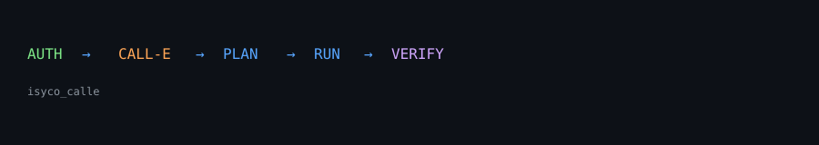

<div align="center">

# ISyCo × CALL-E

**Authority-gated phone calls for agent workflows.**




</div>

---

## The 30-second version

- An agent hits a task with no API — only a phone number. This bridges that gap.
- Structured request in → authority check (4 explicit gates) → real CALL-E call → structured result out.
- **Capability ≠ authority**: a caller does not get the power to call by existing. Denied means no call.
- Fully tested offline (28 tests, mock-only), live-tested against the real CALL-E SDK.
- Evidence-first: everything claimed is backed by a probe, a test, or a checksum.

## Quickstart

```bash
git clone https://github.com/DannyBaanks/ISyCoCALL-e.git
cd ISyCoCALL-e
py -m venv .venv
.\.venv\Scripts\python -m pip install -e .
```

Then run the golden demo (mock, offline, no credentials needed):

```powershell
.\.venv\Scripts\python -m isyco_calle.demo
```

## What it does

It's a clean slice of architecture for agents that need to call somebody:

```
structured request  +--->  [contract validation]  +--->  [authority gate]
                                                              |
                                    4 checks: technically_possible
                                              authorized
                                              policy_allowed
                                              verified
                                                              v
                                              [CALL-E provider: calle-ai SDK]
                                                              |
                                                              v
                                              [real outbound phone call]
                                                              |
                                                              v
                                    normalized result: success | failed | rejected | timeout
                                                       | provider_error | not_demonstrated
                                                       + request_id, transcript, evidence
```

Only if all four gates pass does the real call happen. If not, the request is
rejected with a reason, before any phone number is dialed.

## Demo

The repo ships a golden two-path demo that shows exactly what we mean:

```
============================================================
  PATH A — denied (no authority grant)
============================================================
[authority] no grant present
[result]    status = rejected
[detail]    authority denied: {...no explicit grant...}
[fact]      provider touched = False      # ← no call, no network

============================================================
  PATH B — authorized
============================================================
[authority] grant issued; verified = true
[provider]  mock (or CALL-E when live)
[result]    status = success / structured outcome
            request_id = mock_...
```

Run it:

```powershell
.\.venv\Scripts\python -m isyco_calle.demo
```

## What exists

| Component | Code | Tested | Live |
|---|---|---|---|
| Contract (`phone.call` request) | `domain/contract.py` | ✅ | — |
| Authority model (4 axes) | `domain/authority.py` | ✅ | ✅ (run) |
| Capability gate | `capabilities/phone_call.py` | ✅ | — |
| Provider: CALL-E adapter | `providers/callee.py` | ✅ | ✅ installer + SDK probe |
| Provider: deterministic mock | `providers/mock.py` | ✅ | (never sold as live) |
| CLI | `isyco_calle/cli.py` | ✅ (doctor/call/status) | ✅ |
| Silent demo | `demo.py` | ✅ | closes both paths above |
| Tests | `tests/` | ✅ 28 pass | ✅ (2 skipped live w/o creds) |

We're explicit: **a real outbound call was NOT placed through this repo** (no `CALLE_API_KEY`
here). What exists was live-verified earlier today by real upstream flows in a separate
repo (`CALL-E-AUTH-RESCUE-HACKATHON`), where the call reached the carrier and the server
outcome cohered with reality. That's where I reproduce before attempting E2E here.

## Why CALL-E

CALL-E is a developer-first platform for getting real phone calls handled — plan a goal,
dial out, adapt in real time, and return a structured result. Importing the official SDK
(`calle-ai`), building to its API (task, result_schema, recipient), and re-checking the
output is more valuable than hand-rolling telephony with years of DTMF problems,
voicemail, silence handling, retries, and compliance rules. This wrapper exists to
make CALL-E safe to use inside a larger system.

## The trust seam

This is not just "a wrapper". This is a boundary specification.

```
getting the capability  !=  having authority to use it
the request            !=  the phone call happening
the call concluding     !=  the task result being truthful
```

Every decision is explicit (and hashable). When a caller asks but isn't allowed, they
get a `rejected` result, not silence. When a call is placed but the carrier never rings
the handset, the result records that distinction. When the answer is `not_demonstrated`,
it's because the evidence didn't support a stronger claim yet.

## Repo map

```
ISyCoCALL-e/
├── isyco_calle/           # implementation (domain/capability/provider/cli)
│   ├── domain/
│   │   ├── contract.py    # request shape + E164 validation
│   │   ├── authority.py   # 4-axis grants (the magic boundary)
│   │   └── result.py      # 6-status normalized result
│   ├── capabilities/phone_call.py
│   ├── providers/callee.py  # real SDK adapter (+mock.py for tests)
│   ├── cli.py             # isyco-call command
│   ├── demo.py            # golden demo with both paths
│   └── config.py          # env-based settings
├── tests/                 # all green offline; LIVE tests skip if no creds
├── docs/                  # SUBMISSION_CHECKLIST, TESTING_INSTRUCTIONS, DEVPOST_FINAL, ...
├── evidence/              # real probe outputs (README + CLI slice), NOT secrets
├── SHA256SUMS.json        # checksum manifest
└── README.md              # you are here
```

## Hackathon integration

Submitted to **CALL-E: Your Code Is Calling** (call-e.devpost.com).

Because I want emphasis on problem-first: the hackathon asks for a real business
problem solved by a call (appointment confirmation, lead qualification, service
inquiry, workflow prevención de cascada, etc). This is how the product answers that
challenge with the simplest possible implementation — but none of the safety stories
"synced" with this project rely on lookups. It relies on the gateway to the phone.

## Learn more

- [get started](#quickstart)
- [how the phone call capability runs](./docs/AUTHORITY_MODEL.md)
- [triage of the CALL-E onboarding seams encountered during this project](./docs/CALL_E_SURFACE.md)
- [submission material we're going to publish](./docs/SUBMISSION_CHECKLIST.md)
- [testing instructions](./docs/TESTING_INSTRUCTIONS.md)

## License

MIT. See LICENSE.
